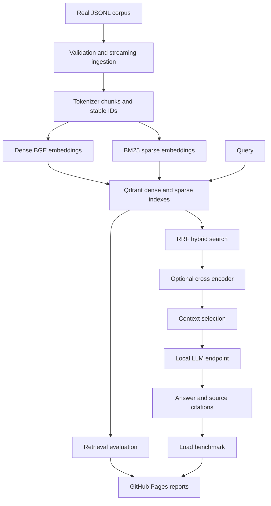

# Large-Scale RAG — 10 Million Documents

A Python reference implementation for scalable retrieval-augmented generation. The 10 million source document target is a design goal, not a measured achievement. No benchmark results are bundled. English is the initial supported language.

## Architecture



## Quick start

Prerequisites: Python 3.11, Docker Engine with Compose, sufficient disk and RAM, and network access for the first model and dataset downloads. The default setup is CPU-based and single-node. GPU use requires the corresponding PyTorch installation. Commands below use a POSIX shell; on Windows use WSL2 or activate `.venv\Scripts\Activate.ps1` in PowerShell and set environment variables with `$env:NAME="value"`.

```bash
python3.11 -m venv .venv
source .venv/bin/activate
python -m pip install --upgrade pip
pip install -e '.[dev]'
docker compose up -d
python scripts/download_scifact.py
rag ingest data/scifact/corpus.jsonl
rag search 'Does exercise improve cardiovascular health?' --mode hybrid --rerank
```

The question above is an example input, not a claimed dataset query or result. The initial corpus is BEIR SciFact. Read its original dataset terms before downloading and using it. The downloader checks the published archive MD5 for accidental corruption; it is not a cryptographic authenticity guarantee.

### Real corpus input

Supply UTF-8 JSON Lines with `_id` (or `id`), `text`, and optional `title`, `source`. IDs must be globally unique within the corpus; namespace IDs when combining datasets. Use original document IDs, not generated chunk IDs. No sample corpus is supplied. Invalid rows stop ingestion with the line number. Content is not deduplicated across different source IDs: that requires a corpus-specific policy to preserve relevance labels. Exact repeats of a known ID and content are skipped. Changes to that ID replace its old chunks. Ingestion uses bounded batches, SQLite checkpoints and acknowledged Qdrant writes. A single extremely long document still requires tokenization memory proportional to its length.

Use a dedicated collection and manifest for each dataset/configuration. For independent scale runs, export `RAG_COLLECTION=rag_100k` (for example), pass `--manifest data/100k.sqlite` and ingest a deterministic corpus subset. `--limit` counts nonempty input rows, not unique documents. Never assume it equals indexed documents. Record dataset version, exact input hash, unique source counts and qrels coverage. Never mix benchmark results from different datasets without labeling them.

```bash
rag ingest /path/to/real/corpus.jsonl --manifest data/full.sqlite
rag delete DOCUMENT_ID --manifest data/full.sqlite
```

Use one writer per collection and manifest. Do not reuse a manifest with an externally deleted or restored collection; rebuild both together. Replay the same immutable input after interruption. Updates and deletes are not atomic across SQLite and Qdrant and should be performed offline or with appropriate read-consistency controls. Deleting a document from the index does not delete it from the source file; replaying that source will restore it. For a full rebuild use a new collection and manifest. Retain the original files independently.

### Generation

Start a compatible local OpenAI-style HTTP server, for example vLLM on a supported GPU machine:

```bash
# Install vLLM in a separate environment according to its official GPU instructions.
vllm serve Qwen/Qwen2.5-7B-Instruct --port 8001
# In the RAG environment:
rag answer 'Does exercise improve cardiovascular health?' --rerank
uvicorn rag_system.api:app --host 127.0.0.1 --port 8000
```

Visit http://127.0.0.1:8000/docs for interactive OpenAPI requests. `/search`, `/answer`, `/health`, `/metrics/` are provided. The API is not authenticated: do not expose it publicly without a gateway, request limits and authentication. Model-server JSON response format support is required. Citations are checked for valid identifiers and agreement with inline references; this does not verify semantic entailment. The context limit is character-based, not an exact LLM token budget. Set a conservative `CONTEXT_CHARS` for the deployed LLM. No streaming or time-to-first-token measurement is implemented.

### Retrieval experiments

```bash
rag evaluate data/scifact/queries.jsonl data/scifact/qrels/test.tsv --mode bm25 --output benchmarks/results/bm25.json
rag evaluate data/scifact/queries.jsonl data/scifact/qrels/test.tsv --mode dense --exact --output benchmarks/results/dense_exact.json
rag evaluate data/scifact/queries.jsonl data/scifact/qrels/test.tsv --mode dense --output benchmarks/results/dense_ann.json
rag evaluate data/scifact/queries.jsonl data/scifact/qrels/test.tsv --mode hybrid --output benchmarks/results/hybrid.json
rag evaluate data/scifact/queries.jsonl data/scifact/qrels/test.tsv --mode hybrid --rerank --output benchmarks/results/reranked.json
rag benchmark data/scifact/queries.jsonl --workers 4 --repeat 2 --output benchmarks/results/load.json
python scripts/build_dashboard.py
```

The evaluator collapses chunk rankings to unique source IDs. It reports Recall, Precision, MRR, nDCG, Hit Rate and query latency percentiles. Candidate truncation may return fewer than K unique documents; Precision still divides by K. Unjudged documents are treated as nonrelevant, as in standard pooled-qrels evaluation. Exact dense search is expensive; use feasible subsets. Approximate-vs-exact ANN neighbor overlap is not yet a separate metric. BM25 uses FastEmbed sparse encoding with Qdrant collection-level IDF; statistics apply to chunks, not whole documents, and the encoder's length normalization defaults are used. Load tests are in-process, not HTTP load tests, and report successful-request latency, failures, QPS and client RSS at completion (not peak RAM). Run warm and cold tests separately; initial model loading happens before timing. No generation correctness or hallucination metrics are claimed without annotated reference answers.

### Scale and deployment

Export `SHARDS`, `REPLICAS`, `HNSW_M`, `HNSW_EF`, `BATCH_SIZE`, `MODEL_DEVICE` as required. See `.env.example`. Shards and replicas are creation-time settings; setting them does not provision machines. Follow Qdrant's official peer bootstrap instructions for a real multi-node cluster. The Compose file is only a local single-node setup. Do not set replicas above available peers. Use SSD-backed persistent storage, snapshots, and monitor indexing completion before experiments. For a genuine 10M run, obtain a licensed corpus with at least 10M unique source documents; measure actual chunk count and provision accordingly. With an illustrative five chunks per document and 384-dimensional FP32 vectors, raw dense vectors alone require 76.8 GB before indexes, metadata, replicas and backups. This is a capacity calculation, not an observed result.

Suggested scale stages: 1K, 10K, 100K, 1M, 5M, 10M unique documents. Preserve judged relevant documents in subsets used to compare quality. Record actual hardware, model revisions, dataset checksums, package lock and database settings with each benchmark. Set DENSE_REVISION and RERANKER_REVISION to verified commit hashes; defaults use upstream revisions and are not fully reproducible. Dependency ranges are provisional; freeze an environment after integration testing. The BGE query prefix is configured for the default English BGE model; changing to a different model requires checking its query template and rebuilding the collection.

### GitHub

Commit source, tests, docs and real benchmark reports only. In Settings → Pages choose GitHub Actions. The workflow builds static reports from JSON. Never commit datasets, vector indexes, model weights, secrets or private queries. The static dashboard does not host Python or the LLM. CI runs lightweight unit tests without downloading models. Run the live smoke test separately after starting Qdrant and ingesting the dataset.

```bash
python -m pytest -q
python -m compileall -q src scripts
python scripts/smoke_test.py
```

### License and sources

Dependencies are open-source packages; model weights and datasets have independent terms. Default candidates: [BGE](https://huggingface.co/BAAI/bge-small-en-v1.5), [MiniLM reranker](https://huggingface.co/cross-encoder/ms-marco-MiniLM-L6-v2), [Qwen](https://huggingface.co/Qwen/Qwen2.5-7B-Instruct). Confirm licenses and the exact revision before deployment or redistribution. [BEIR](https://github.com/beir-cellar/beir), [Qdrant hybrid search](https://qdrant.tech/documentation/hybrid-queries/), [distributed deployment](https://qdrant.tech/documentation/distributed_deployment/), [vLLM](https://docs.vllm.ai/). A repository license has not been selected on the owner's behalf.

### Validation and known gaps

This delivery is a runnable-intent reference implementation, not a certified production system. Pure Python tests and syntax compilation ran successfully in the build environment. Qdrant, FastEmbed, Sentence Transformers and local LLM end-to-end execution still require external services/downloads. No verified 10M corpus, GPU or cluster was available. Additional work includes corpus-wide content deduplication, token-aware generation budgeting, generation quality evaluation, caching, full server-side telemetry, quantization experiments, distributed failure testing, transactional updates, and reproducible dependency locks. No benchmark values are invented.
